<div align="center">

# Glass UI

**A glass look for the web.** One stylesheet, one small script, plain HTML.<br>
No dependencies, no build step.

[Live demo](https://sanprojects.github.io/glass-ui/) · [npm](https://www.npmjs.com/package/glass-ui-css) · MIT

[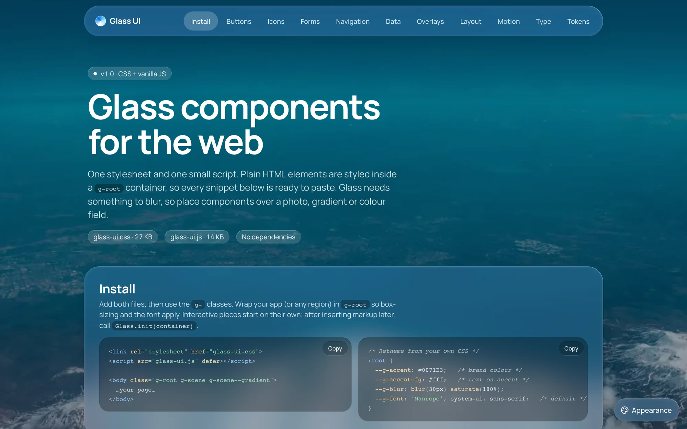](https://sanprojects.github.io/glass-ui/)

</div>

Translucent, blurred panels over a photo, gradient or colour field. Themed through CSS tokens: dark by default, light optional.

## Quick start

```sh
npm i glass-ui-css
```

```html
<link rel="stylesheet" href="glass-ui.min.css">
<link rel="stylesheet" href="glass-icons.min.css">
<link rel="stylesheet" href="glass-ui-light.min.css"> <!-- optional light theme -->
<script src="glass-ui.min.js" defer></script>
<link rel="stylesheet" href="glass-morph.min.css"> <!-- optional: Glass.morph, data-g-morph -->
<script src="glass-morph.min.js" defer></script>

<body class="g-root g-scene">
  <button data-variant="primary" data-icon="play">Play</button>
</body>
```

Native elements (`button`, `input`, `table`, `dialog`, `nav`, `article`…) are styled inside `.g-root`. Variants and states are attributes: `data-variant`, `data-size`, `aria-*`. The [live demo](https://sanprojects.github.io/glass-ui/) shows every component with its markup.

## Components

### [Buttons and icons](https://sanprojects.github.io/glass-ui/#buttons)

Primary, glass, light, outline, recessed, plain (an icon or text without a pad: `data-variant="plain"`) and danger variants, three sizes, icon-only and block buttons, toggle and removable chips, plus a Lucide icon pack added with `data-icon`.

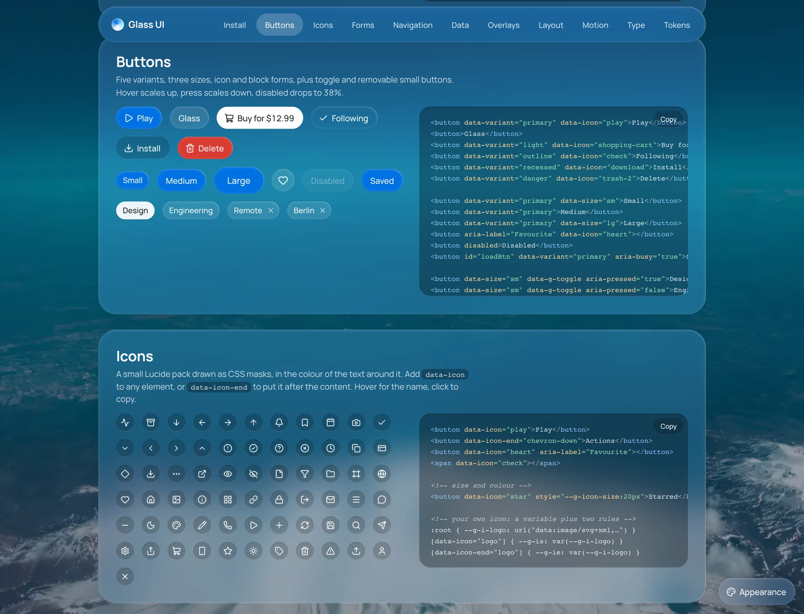

### [Forms](https://sanprojects.github.io/glass-ui/#forms)

Recessed fields with icons and validation states, number stepper, date, time and colour pickers, file drop zone, select with search and multi-select, checkboxes, radios, switches and sliders. All are plain form controls, so they submit and validate natively.

A form is an adaptive grid: any container that holds `.g-field` children lays them out in columns of equal width, never narrower than an input (200px), with one gap between them. The labels, controls and hints of one line share their rows (subgrid), so the controls stand on one line. A lone field takes the whole row. A field without a label (a button: `<div class="g-field"><button>Go</button></div>`) stands at the height of the controls beside it, and in a grid too narrow to put anything beside it becomes a row of its own.

**Address.** A `<form method="get">` whose `action` names the current page (the form of `<main>`, or else one elsewhere, such as the search box in the header) keeps its fields in the address and loads its answer in place, with nothing to set up. The address is built in the browser, at once: `action="/find-words/{word}"` puts that field into the path, every other field goes into the query in the order of the form, and a field at its default is left out (an empty text, an unchecked box, the first option of a select, the first radio of a group): `/find-words/апельсин?strong=cities&repeat=1`. A form without a submit button answers as it is filled in (one history entry per edit, one per choice); a form with one waits for it and asks anew on every submit (a random pick, a ping). The clear cross of a field is one more button: the answer with that field empty comes at once; a value a script puts into a field and announces with `change` (a tile that puts its name into the box) is an entry of its own. The answer is a GET of the same address with the header `X-G-Fetch: 1`; what differs from the last answer is morphed in (`Glass.morph`) by the smallest elements with an `id` that hold the change, so the rest of `<main>` and what other scripts put there are left alone, and `<title>`, canonical and description follow. When the user changed the form (typed, chose, cleared, sent), the request also says `X-G-Form: <its id>`: the form on the page already is what the answer would draw, so the server may send it back empty as `<form id="…" data-g-same>`, holding only what the answer writes into it: its `<output>` elements (results, put in by id) and its hidden fields (by name, remembered with the history entry); a link or back / forward asks for the whole page. Back / forward, and links to addresses of the form, put the fields and the answer back (seen before: no request). A page that works the answer out itself (a filter over what it already holds) cancels `g:answer` `{ url }` on the form, which comes before every answer and at once on every keystroke: nothing is asked, the page shows the answer from the fields, and the kit keeps the address and the history. A change outside every element with an id, or an error, loads the page the usual way, and without JavaScript it is a plain GET form. A `<form method="post">` whose `action` names the page is sent in the background the same way: its answer is morphed in (a change outside every element with an id morphs `<main>` as a whole), what is typed and the focus stay, the address does not change; an error or an answer that is not HTML (a file) lets the browser send the form itself. A form with no `action`, with `data-g-url="off"`, or whose submit a script of the page cancels (from that submit on) is left to the page; `g:navigate` `{ url, title }` on `document` after each answer is for analytics.

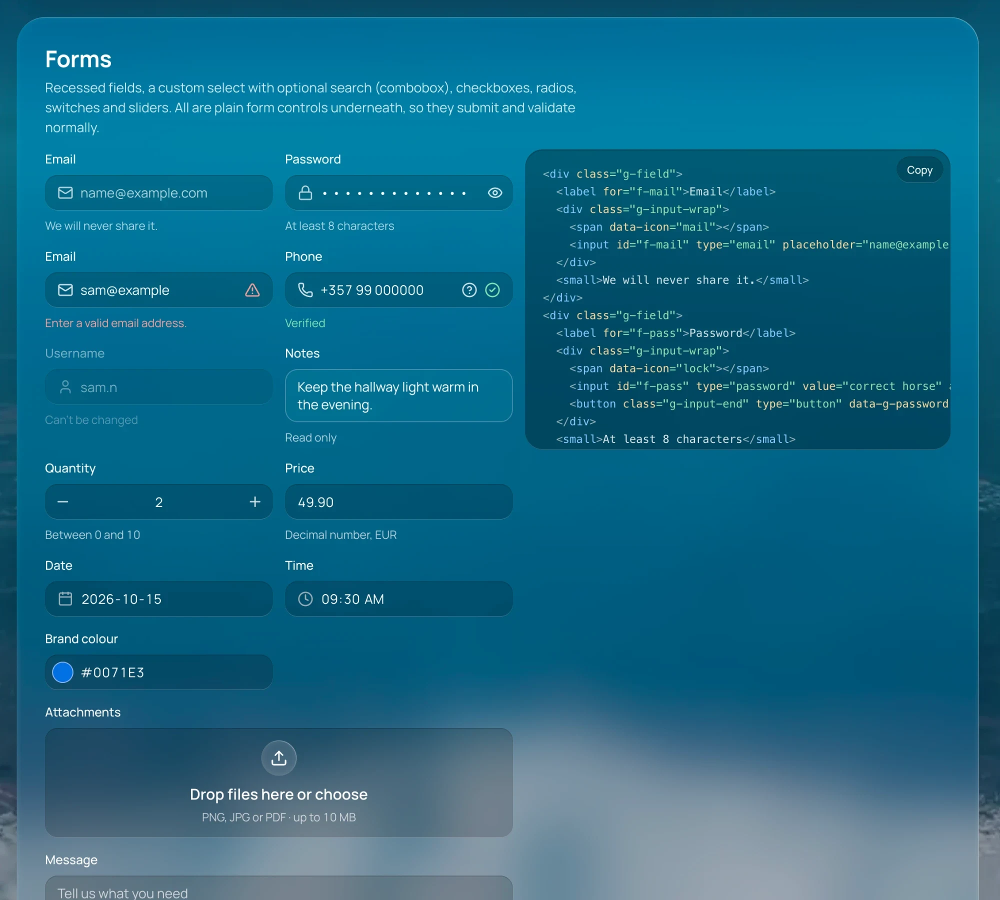

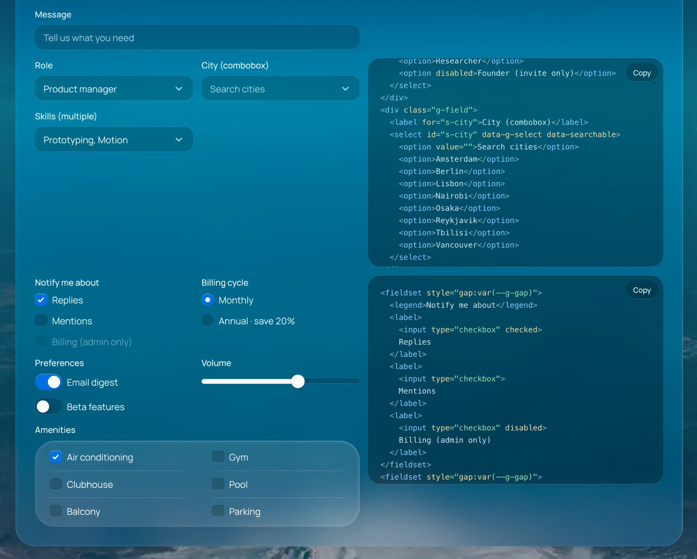

### [Navigation](https://sanprojects.github.io/glass-ui/#navigation)

A floating `<nav>` bar that builds its links from page sections and folds the overflow into a More menu, plus pill and underline tabs with arrow-key support.

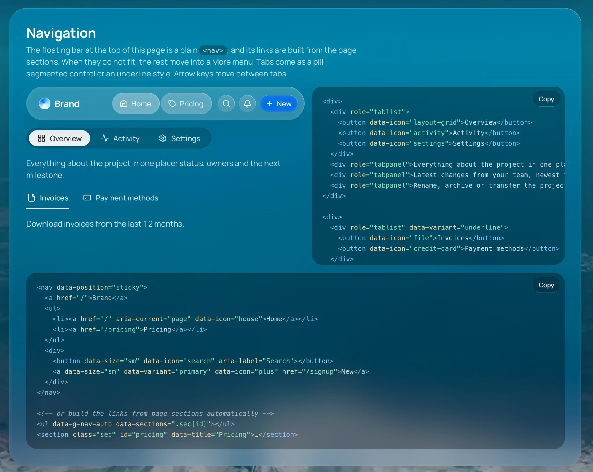

### [Data and content](https://sanprojects.github.io/glass-ui/#data)

Cards (static and fully clickable), badges, progress bars, ring and spinner, a sortable table with row selection and pagination, numbered and bulleted lists.

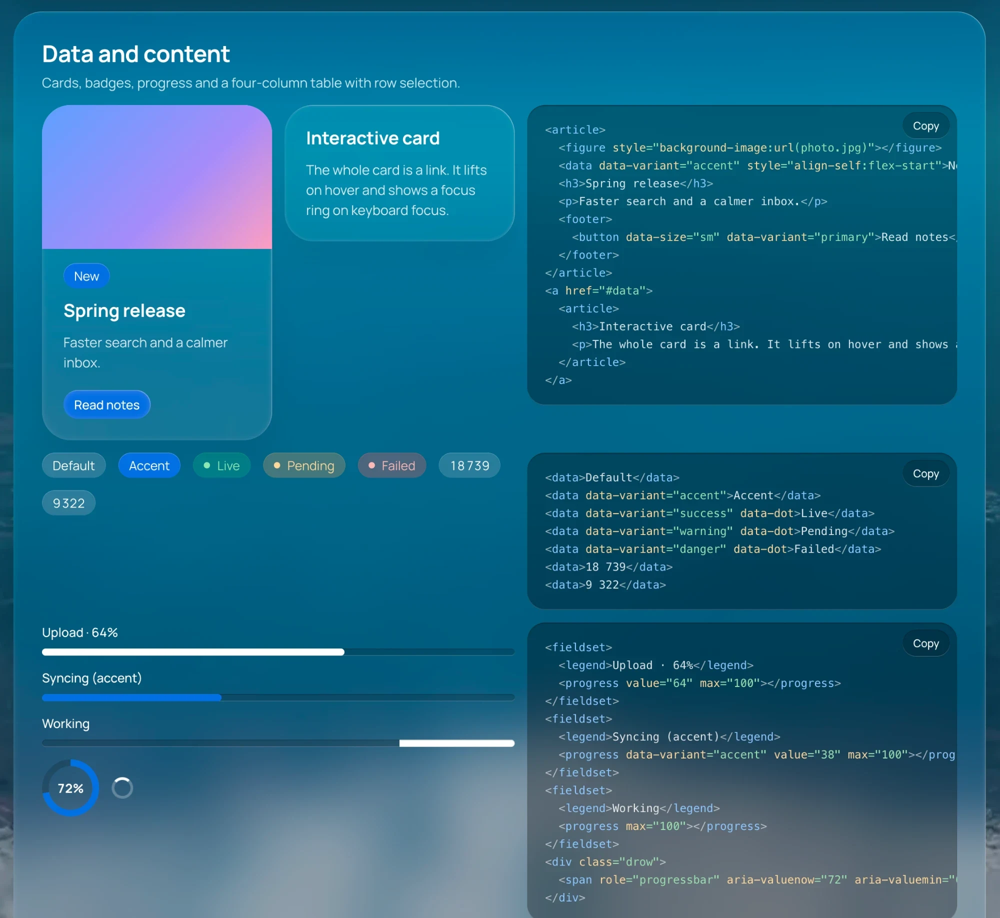

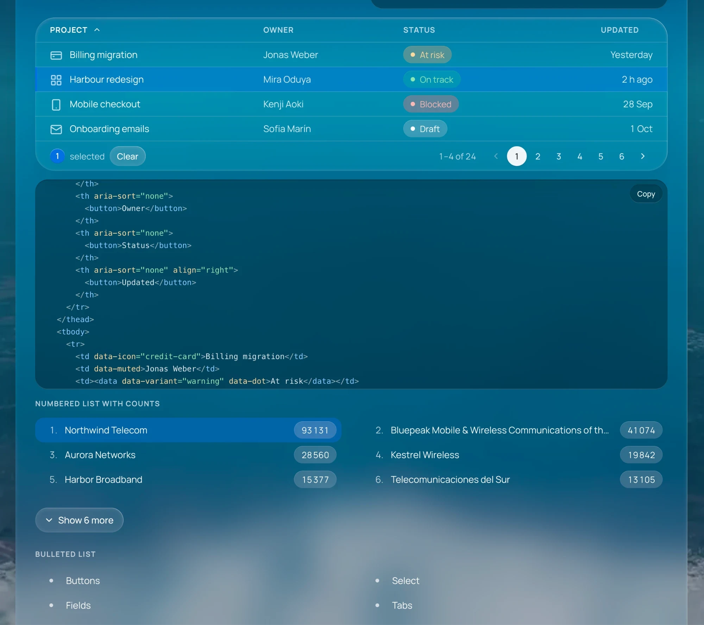

### [Overlays](https://sanprojects.github.io/glass-ui/#overlays)

A dialog on the native `<dialog>` element (focus trap, Esc to close), tooltips, menus and toasts triggered from JavaScript.

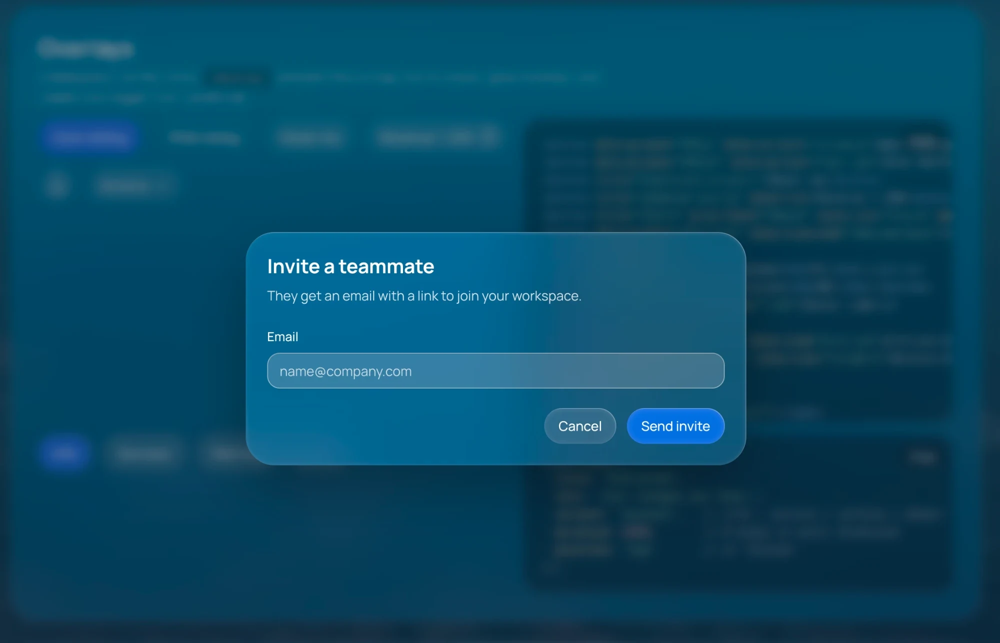

### [Layout](https://sanprojects.github.io/glass-ui/#layout)

An app shell with a tool panel, a workspace and an inspector. The inspector uses the stronger glass; below 900 px the panels stack.

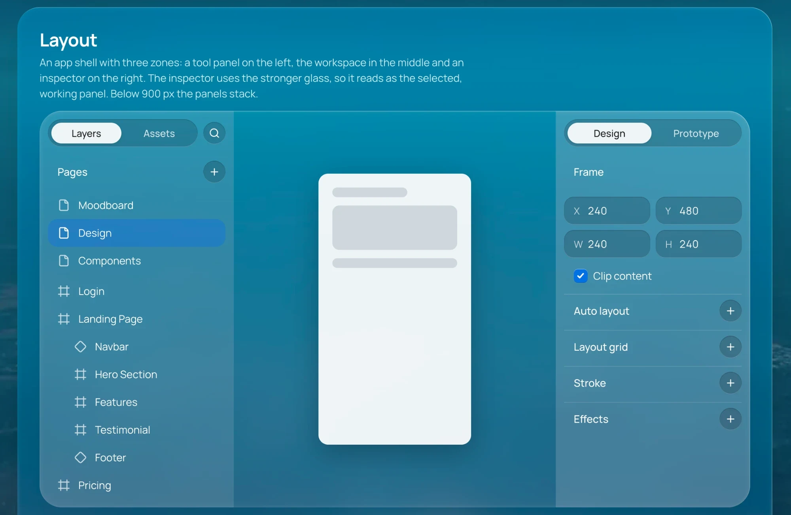

**Ruler**: a section index for a long scrolling box. Put `data-ruler="Name"` on the elements that start a section (without a value the name is the element's `id`, else its text): the nearest scrolling box (a block or flex container) gets the ruler by itself (`data-g-ruler` on a box asks for it explicitly): a hairline with the name under it appears at the right edge, left of the scroll bar, as tall as the section's share of the scroll height; the section in view is lit; a click scrolls there (with reduced motion it jumps). Every mark is a link to its section (`#id`, the id of the marked element, or one made of the name): a click puts it into the address, and an address with `#id` opens that section on load and on back / forward. It floats over the content and does not move it; to keep the content clear of it add `padding-inline-end: calc(var(--g-ruler-w) + 2 * var(--g-gap))` to the box. The standard scroll bar stays. When nothing around the marked elements scrolls, the page does: the ruler is then fixed at the right edge of the window, under a fixed or sticky `<nav>` / `<header>`. For virtual lists pass the sections by hand: `Glass.ruler(box, [{ label, from, to }])` (px of the scrollable height).

### [Motion](https://sanprojects.github.io/glass-ui/#motion)

Seven effects you add with a single class: appear, shimmer, ripple, pulse, highlight, rotate and zoom. Each plays once; add `g-anim--loop` to repeat, `--g-anim-delay` to stagger a list, or call `Glass.animate(el, 'highlight')` from JavaScript.

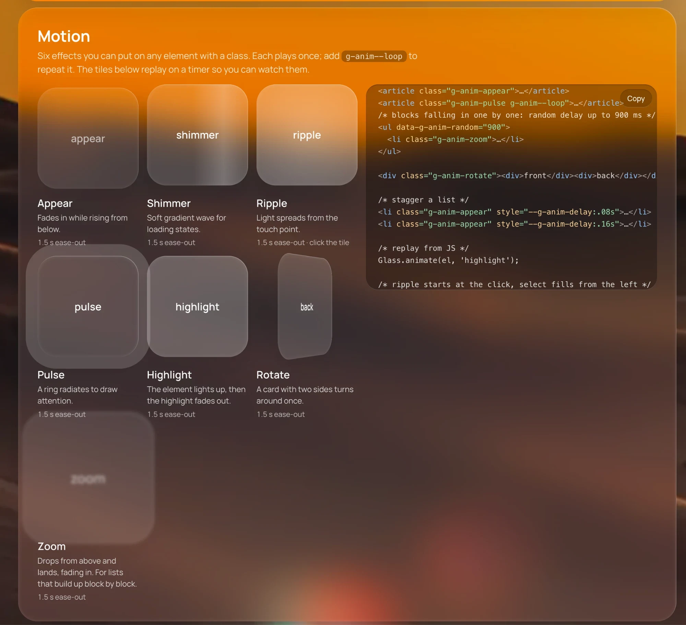

**Morph** is a library of its own: `glass-morph.js` + `glass-morph.css`, no dependencies, with or without the kit (with the kit it also measures `[data-g-fit]` columns in an update, highlights with the kit's effect and ends the kit's busy line; the kit's in-place form answers need it). `Glass.morph('#result', html)` swaps the content of a box for new content and animates only the difference: rows that are gone slide out, new rows slide in (the ones on the screen only), a changed text lights up, and a number that changed turns its digits like an odometer. It works for any elements, not only lists. Elements that are in both versions stay the same nodes, so focus, scroll and typed values survive. Pair rows with `data-key` (a list row of words: `<li data-key="word">`); without it an element is paired by its text. Returns a Promise. Tune it with `--g-morph-leave`, `--g-morph-enter`, `--g-morph-stagger`, `--g-morph-reel`.

**Watched box.** `<div data-g-morph>` animates whatever changes in it, whoever changed it: a script that writes `innerHTML`, a framework that adds, removes and moves rows, `textContent` of a counter. A `MutationObserver` tells what went and what came; where things stood is kept beforehand (read when the box settles), so the rows that went fade out where they stood, the new ones come in, the rest glide from their old places, a word that went to another list glides there, and a number turns. Pairs are found as `Glass.morph` finds them (`data-key`, `id`, the text of a row). Its nodes are not replaced: the new ones are the page's, so the page's references and listeners stay valid; what went is shown by a copy. `Glass.watch(el)` watches a box made later (a box with `data-g-morph` added later is found by itself); it returns a function that stops watching. `Glass.morph` into a watched box is animated once. Use `Glass.morph` where the box holds what the user is doing (a form being typed in): it keeps the old nodes; in a watched box the page's own write has replaced them already.

**Watched page.** `<body data-g-morph>` watches the whole page: any change anywhere is animated, with no box to mark. What the page writes while it loads is not animated (only what changes once it has loaded and the browser is idle). A box with its own `data-g-morph` in it animates its own changes (it also takes its new height smoothly); the page leaves them to it. Never animated: the kit's parts that run by themselves (select, toast, tooltip, "more", pager, ruler, the cross of a field), what floats over the page (`[popover]`, `dialog`, a `fixed` layer, an `absolute` one right in `<body>`), `svg`, what the user edits (`contenteditable`, `textarea`, `select`), `aria-hidden` decoration, and whatever is inside `[data-g-no-morph]`. An element that changes again within 80 ms twice in a row (a clock, a running counter) is left as it is until it pauses, and so is the page while it changes on every frame (a game, a live chart). A row of a `.g-list` that is shown (its `hidden` removed) comes in. What is below a change glides to its new place. What stays in the window as the page scrolls (fixed, sticky) is measured in the window. What is not drawn (`display: none`, what a closed `<details>` holds) is not read at all: a read would make the browser work out its styles.

**Morph's animations are CSS.** What comes in gets `.g-morph-enter`, what goes `.g-morph-ghost` (glass-morph.css); their timing is in custom properties that inherit (`--g-morph-d` when, `--g-morph-enter` / `--g-morph-run` how long). So a page decides in its own CSS what of the element moves: a fading element is a backdrop root, so glass (`backdrop-filter`) inside a wrapper that fades blurs nothing until the end; let the glass fade itself: `a.g-morph-enter { animation: none !important } a.g-morph-enter > article { animation: g-morph-in var(--g-morph-enter) ease-out var(--g-morph-d) backwards }`. `Glass.morphSkip = 'selector'` names parts that are not content for it (a UI kit's own widgets; glass-ui.js sets its own). What goes fades out in its own parent, out of the flow; selectors still see it there (`:has()`, `:last-child`, `:empty`), so each update checks that what stays stands where it will stand once the ghosts are gone, and where it would not, the ghosts of that parent go at once instead of fading: nothing jumps at the end. A page that wants those rows to fade too writes the selector so that it skips them (`:not(.g-morph-ghost)`). While the page scrolls (the window or any box in it, within 200 ms of the last scroll event) nothing is animated: what changes then is drawn for the scroll (a virtual list writing the rows that come into view, rows loaded near the end, a panel showing what came under the still pointer).

### Appearance

<table>
<tr>
<td width="34%" valign="top">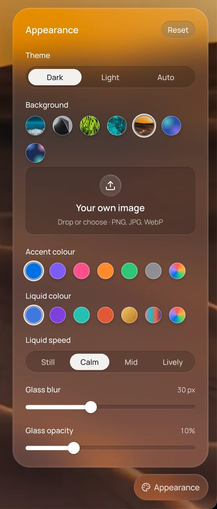</td>
<td valign="top">

An optional settings panel (`glass-appearance.css` / `.js`) that the demo uses to restyle the page live:

- **Theme**: dark, light or auto
- **Background**: a scene from the set, or your own image
- **Accent colour** and **liquid colour**
- **Liquid speed**: still, calm, mid, lively
- **Glass blur** and **glass opacity**
- **Reset** to defaults

</td>
</tr>
</table>

Also in the demo, without screenshots here:

- **[Type](https://sanprojects.github.io/glass-ui/#type)**: styles for `h1`…`small` and `g-prose`, with a font and language switcher.
- **Empty state**: `<div class="g-empty" data-icon="search"><h4>Title</h4><p>Hint</p></div>`, a centred icon with a title and a hint, for a search with no results.
- **Message**: `<div class="g-alert" data-icon="triangle-alert" data-tone="warning" role="status">Text with <b>emphasis</b>.</div>`, an icon and a text inside the page; `data-tone` is `warning`, `danger` or `success`, no tone is neutral.
- **[Tokens](https://sanprojects.github.io/glass-ui/#tokens)**: `--g-accent`, `--g-fill`, `--g-blur`, `--g-radius-*` and more; override on `:root` or any container to retheme a region.

## Files

| File | Purpose |
|---|---|
| `glass-ui.css` / `.js` | the kit |
| `glass-morph.css` / `.js` | Morph: `Glass.morph`, `Glass.watch`, `data-g-morph` (works on its own too; `node bench/vs-auto-animate.mjs` compares it with auto-animate) |
| `glass-icons.css` | icon pack, used as `data-icon="name"` |
| `glass-ui-light.css` | light theme: `Glass.setTheme('light' \| 'dark' \| 'auto')` |
| `glass-ui-liquid.js` | optional animated background |
| `glass-appearance.css` / `.js` | optional settings panel used by the demo |

Each file also ships as `.min.css` / `.min.js`.

## Good to know

- **Spacing** is one rhythm owned by the parent (`gap`), children carry no outer margin: `--g-gap` (16px) between neighbours, `--g-gap-inner` (8px) inside one component, `--g-inset` (16px) a control's side padding, `--g-pad` (24px) container padding. Documented exceptions: optical alignment of icons, the card media bleed, menu separators and `.g-prose`. `test/spacing.test.mjs` measures the gaps in the demo and fails on off-rhythm values.
- **Type scale** is seven steps: `--g-fs-caption` 12, `-footnote` 13, `-subhead` 15 (controls), `-body` 17 (running text), `-title3` 20, `-title1` 28, `-title-lg` 34. Use the tokens, not px values; sizes in `em` (inline code, math) stay relative to their text.
- **Fonts** are not shipped. The kit uses `Manrope` if you load it, otherwise the system font. Set `--g-font` to use your own.
- **Icons** are a subset of [Lucide](https://lucide.dev) (ISC licence, © Lucide Contributors), generated into `glass-icons.css`. Add your own as described in that file.
- **Browsers:** current evergreen browsers.

## Tests

```sh
npm i
npx playwright install chromium
npm test
```

## Licence

MIT
